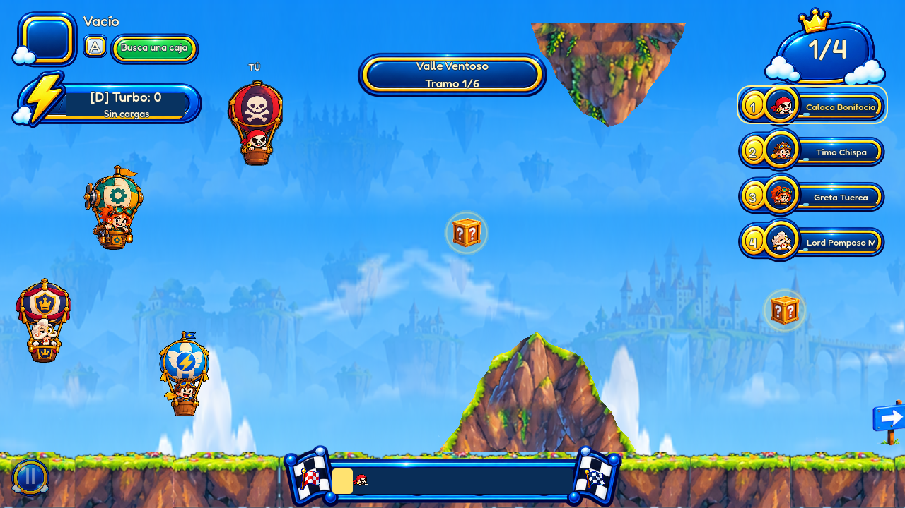
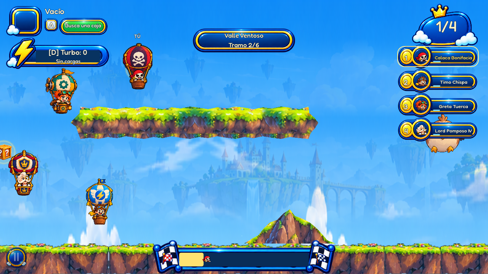
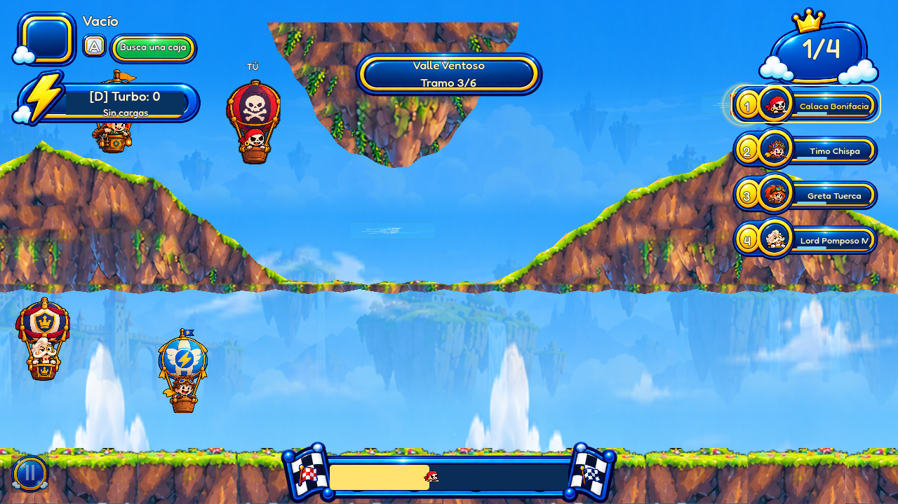
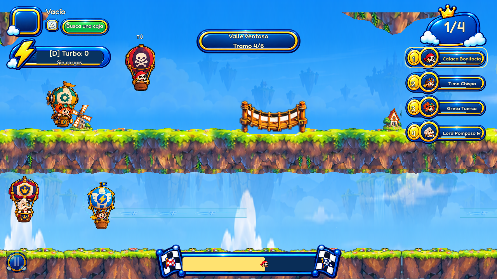
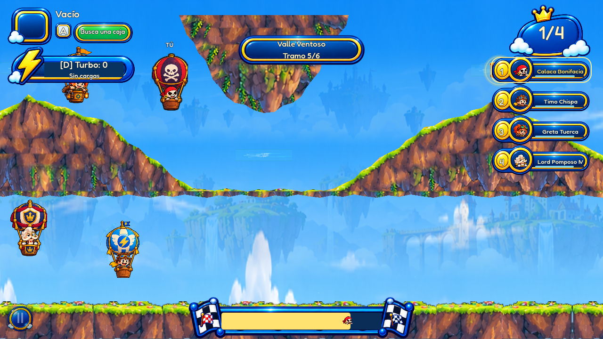
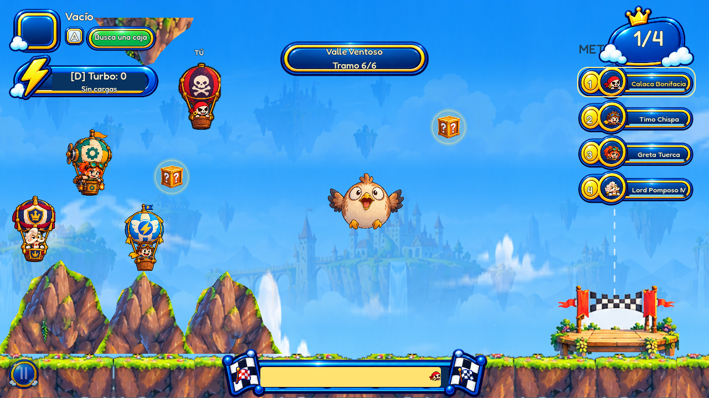

# Valle Ventoso: integración modular — 2026-10-25

Rama `work/valle-terrain-art-2`, sin commit, push ni merge. Esta intervención conserva el balance previo y modifica exclusivamente la presentación del circuito. No constituye aceptación artística final: siguen pendientes variantes para masas grandes, limpieza del kit y rendimiento en hardware objetivo.

## Implementación

`scripts/terrain_kit_visual.gd` compone suelo, pendientes, coronas, caras rocosas y remates colgantes con Sprite2D del kit. `world_visual.gd` construye estos nodos bajo `WorldVisual/TerrainVisual`, separados de los colliders. Los antiguos polígonos de color se ocultan; los nuevos Polygon2D son máscaras de recorte, no rellenos marrones. Las piezas conservan proporción; las rampas se orientan según la pendiente. Dos shaders mezclan solamente el alfa de las uniones, sin deformar texturas.

El contorno visual incorpora pequeños entrantes hacia el interior de la roca (hasta 8 px), caras superpuestas, picos y remates específicos. Se mantiene el perfil general jugable: esta decisión conserva los corredores, pero todavía limita la variedad de las siluetas grandes. En S4 hay un rebaje visual de 16 px bajo el puente; el collider permanece intacto. Molino, casa y puente se apoyan en la meseta amplia, fuera de los pasos estrechos. Se retiraron las antiguas decoraciones incrustadas en las caras rocosas.

Los 37 PNG, README y manifiesto originales se encuentran en `assets/environments/valle_ventoso/terrain_kit/`. Se trasladó la copia local que estaba bajo `assets/worlds/...`; no se modificó el repositorio externo de gráficos ni se retocaron los PNG. Se utilizan regiones limpias de algunos recortes, conservando los originales para su corrección artística.

## Comparativas en Godot, 1280 × 720

Las capturas usan la cámara real, cuatro corredores inmóviles y las mismas posiciones de pista para ambos renders. El «antes» usa el renderer anterior con el **layout jugable actual**, para aislar el cambio artístico; no representa una reversión del balance. Nubes y animaciones pueden diferir de fase. Son seis encuadres representativos, no una grabación del recorrido completo ni playtesting humano.

### S1 — Vuelo inicial

Pico con cara rocosa y borde de césped, roca colgante con remate vegetal; se conserva la separación de obstáculos y la lectura de las cajas.

[Antes](before/valle-preview-s1.png) · [Después a tamaño completo](valle-preview-s1.png) · [Efectos reducidos](valle-preview-s1-reduced.png)



### S2 — Alternancia

La plataforma central combina coronas de isla, base de roca y borde irregular. El pico inferior y Flappy conservan sus posiciones. La plataforma larga aún necesita más variantes de remate.

[Antes](before/valle-preview-s2.png) · [Después a tamaño completo](valle-preview-s2.png) · [Efectos reducidos](valle-preview-s2-reduced.png)



### S3 — Paso superior estrecho

Rampas con césped, planos de roca y remate de techo. No se coloca puente ni decoración en el paso rápido. La cascada de primer plano queda pendiente por defectos de extracción; las cascadas del fondo pertenecen al parallax existente.

[Antes](before/valle-preview-s3.png) · [Después a tamaño completo](valle-preview-s3.png) · [Efectos reducidos](valle-preview-s3-reduced.png)



### S4 — Bifurcación

Divisor compuesto con césped y roca, molino, casa y puente sobre una depresión visual poco profunda. Corrientes conservadas por abajo; ambas rutas siguen abiertas. La cara larga todavía muestra repetición y requiere módulos mayores para alcanzar calidad final.

[Antes](before/valle-preview-s4.png) · [Después a tamaño completo](valle-preview-s4.png) · [Efectos reducidos](valle-preview-s4-reduced.png)



### S5 — Segundo paso estrecho

Composición de pendientes y techo con variación determinista de caras rocosas, sin props dentro del corredor. Su parentesco visual con S3 sigue siendo excesivo: faltan variantes de formación que diferencien ambos sectores sin afectar sus pasos.

[Antes](before/valle-preview-s5.png) · [Después a tamaño completo](valle-preview-s5.png) · [Efectos reducidos](valle-preview-s5-reduced.png)



### S6 — Llegada

Picos con remates individuales, techo rocoso y salida despejada hacia la meta. Se conserva el castillo de fondo y se evita añadir props cerca de las cajas y Flappy.

[Antes](before/valle-preview-s6.png) · [Después a tamaño completo](valle-preview-s6.png) · [Efectos reducidos](valle-preview-s6-reduced.png)



## Pendientes artísticos identificados

Consultar la [lámina de inspección del kit](kit-contact.png), el [README original](../../assets/environments/valle_ventoso/terrain_kit/README.md) y el [manifiesto](../../assets/environments/valle_ventoso/terrain_kit/manifest.json).

- `water/waterfall_straight`, `waterfall_curved`, `waterfall_double`: halos oscuros y restos del atlas. `waterfall_background`: texto y fragmento vertical ajeno. No se integran nuevas cascadas con estos defectos. Requieren alfa limpio y nacimiento/remate separados para anclarlas a bordes y caer al aire.
- `props/directional_signs`, `bunting`, `fence`: restos de rótulos o contenido ajeno; `directional_signs` no ofrece una señal limpia. No utilizados.
- `props/tree_round`, `tree_pine`: recortes con elementos vecinos. No utilizados como árboles independientes.
- `props/house`, `windmill`, `wooden_bridge`: fragmentos vecinos en bordes. Se excluyen mediante regiones de Sprite2D; el PNG original sigue necesitando limpieza y pivote de apoyo homologado.
- `terrain_lower/lower_peak_small`: fragmento vecino derecho, excluido mediante región. Requiere extracción limpia completa.
- `islands/island_large` y varias piezas `terrain_upper`: cortes abruptos del atlas, coronas incompletas y uniones no continuas. Se necesitan extremos completos, bases colgantes variadas y variantes de roca sin césped interior.
- Las piezas originales tienen aproximadamente 87–178 px de ancho. No se estiran para cubrir paredes; aun así, su tamaño y la falta de variantes producen repetición perceptible, sobre todo en S3–S5 y en el suelo. Hacen falta módulos grandes dibujados para esas masas, no ampliar destructivamente estos PNG. No se declara resuelto el objetivo de calidad artística final.

## Validación y límites

Godot 4.7.2 Standard, Compatibility/ANGLE. PASS sin fallos en `world_visual_test.gd`, `valle_redesign_test.gd` y `game_feel_test.gd`. La primera verifica manifiesto/dimensiones, composición visual, proporciones, límite de entrantes y conservación de geometría, cajas, corrientes y referencias. La segunda mantiene los tiempos de rutas y cero colisiones de las simulaciones previas; la tercera verifica la presentación y su modo reducido. Comparación SHA-256 contra el inicio del pase: ningún cambio en Track01, scripts jugables ni recursos de configuración registrados.

Revisión visual asistida de seis capturas normales y seis con efectos reducidos, a 1280 × 720. No sustituye una sesión humana jugando ni prueba cada cámara intermedia. Persisten avisos del entorno sobre certificados; algunas ejecuciones también muestran avisos de escritura de logs/perfil o recursos al cerrar.

Diagnóstico gráfico en S3, Intel HD antigua, ANGLE, cuatro corredores con turbo, 60 frames de calentamiento y una muestra de 90 frames: antes 29,38 ms medios / 32,39 ms p95 / 137 draw calls; después 45,09 ms / 52,52 ms / 228 draw calls. Equivale aproximadamente a 34,0 frente a 22,2 FPS en esta muestra. Existe un coste de rendimiento relevante; no se acreditan 60 FPS ni preparación para publicación. Datos: [antes](benchmark-before.json), [después](benchmark-after.json). Pendiente optimizar agrupación/atlas cuando se disponga de piezas definitivas y perfilar el hardware objetivo.

Para reproducir capturas actuales (el ejecutable puede llamarse `godot` o usarse por ruta absoluta):

```powershell
godot --path . --rendering-driver opengl3_angle --fixed-fps 60 --script res://tests/valle_preview.gd -- kit
godot --path . --rendering-driver opengl3_angle --fixed-fps 60 --script res://tests/valle_preview.gd -- kit reduced
godot --headless --path . --script res://tests/world_visual_test.gd
godot --headless --path . --script res://tests/valle_redesign_test.gd
godot --headless --path . --script res://tests/game_feel_test.gd
```

La opción de captura `before` requiere el renderer histórico preparado localmente en `.godot/world_visual_original.gd`; las imágenes del antes se entregan ya guardadas. No se conserva un segundo sistema visual de producción.

Referencias oficiales consultadas: [Sprite2D y regiones](https://docs.godotengine.org/en/stable/classes/class_sprite2d.html), [CanvasItem y recorte de hijos](https://docs.godotengine.org/en/stable/classes/class_canvasitem.html).
